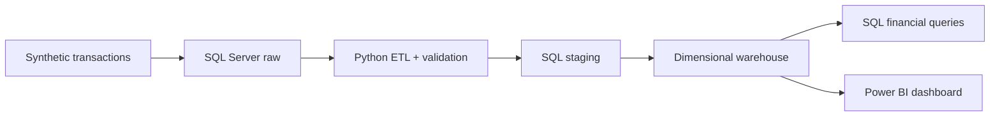

# Finance Analytics | From Transaction Data to Decision-Ready Reporting

**100,000 synthetic transactions · SQL Server · Python · Power BI**

The product generating the most revenue wasn't the one with the highest operating margin. The department contributing the most operating profit wasn't the margin leader either.

This finance analytics project examines those differences through transaction-level reporting, profitability analysis and data-quality checks. It uses **synthetic transactions with healthcare-themed customer names**—not hospital accounts, insurance claims or actual healthcare business results.

Adding a screenshot after uploading the final dashboard image to assets/executive-overview.png:


## The financial picture

**USD only · 2024–2026 transaction period**

| Measure | Result |
|---|---:|
| Available revenue | **$4.231B** |
| Operating profit, complete rows | **$1.265B** |
| Operating margin, complete rows | **29.94%** |
| USD transactions | **33,261** |
| Complete USD financial records | **33,153** |

Across all currencies, the dataset has **100,000 records**; **99,692** have nonblank revenue, cost of goods and operating expense. USD, EUR and INR are **never treated as an FX-converted consolidated total**. Operating margin uses revenue from the same complete-record population as operating profit.

## What emerged from the analysis

**Revenue leader ≠ margin leader.** Product D recorded **$859.34M** in available USD revenue, ahead of Product B at **$850.25M**. But Product B's operating margin was **30.13%**, compared with **29.85%** for Product D. Revenue scale and profitability rate answer different questions; neither establishes the cause of the difference.

**Profit contribution ≠ margin efficiency.** Marketing generated the highest USD operating profit (**$215.81M**), while Operations had the highest department operating margin (**30.14%**). A finance review needs both measures before deciding which departments merit deeper cost analysis.

**The largest customer wasn't the whole story.** BlueSky Retail generated **$437.43M**, approximately **10.34%** of available USD revenue. This identifies the leading account for investigation, not proof of dangerous customer concentration.

**Not all rows can support a profit calculation.** The data contains **308 records** missing one or more financial amounts. A missing expense is not zero. Transaction counts, available revenue and profit-eligible transactions therefore use explicitly different definitions. The report also surfaces quality flags instead of silently dropping flagged records.

## How the analysis was built



The warehouse contains a transaction fact table and **Date, Customer, Product, Department, Region and Currency** dimensions.

| Technology | Role |
|---|---|
| Python, Pandas, SQLAlchemy | Generate, profile, transform and stage transactions |
| SQL Server / T-SQL | Raw and staging layers, dimensional model, financial queries |
| Power BI / DAX | Financial KPIs, filters, drill-down reporting |

## What stakeholders can explore

| Report page | Question it answers |
|---|---|
| Executive Overview | What do revenue, operating profit and margin show together? |
| Revenue Analysis | Which products, departments and regions contribute revenue? |
| Profitability Analysis | Where do absolute profit and operating margin diverge? |
| Customer Analysis | Which accounts contribute revenue and transaction activity? |
| Transaction Details | Which transactions explain a reported number? |
| Data Quality Issues | Which records or fields need checking? |

The intended audience is **FP&A and finance analysts, finance managers, commercial and regional teams, and BI analysts**. These are potential users of a simulated reporting scenario—not stakeholders in a deployed system.

## Repository

```text
Finance-Analytics-GitHub/
├── README.md
├── python/
│   ├── generate_finance_data.py
│   ├── etl_stage3.py
│   ├── test_connection.py
│   └── app.py
├── sql/
│   ├── SQLQuery1.sql
│   ├── SQLQuery3.sql
│   ├── SQLQuery4.sql
│   ├── SQLQuery5.sql
│   ├── SQLQuery6.sql
│   ├── SQLQuery7.sql
│   ├── SQLQuery8.sql
│   ├── SQLQuery9.sql
│   └── SQLQuery10.sql
├── data/
│   ├── FactTransactions.csv
│   └── DimCurrency.csv, DimCustomer.csv, DimDate.csv,
│   │   DimDepartment.csv, DimProduct.csv, DimRegion.csv
├── assets/                      # Add dashboard screenshots later
```

The SQL and Python files show the transformations and financial logic; the supplied CSV extracts allow the results to be inspected. Screenshot and PBIX links will be added when the final files are uploaded.

**Scope:** This is a portfolio analysis of synthetic data, not a production deployment. The comparisons are descriptive: they support financial investigation, not claims of actual savings, performance improvements or established causes.
